# Hola, soy José Luis Mora

Especialista en **email marketing para ecommerce y pymes**, en Barcelona. Más de 15 años diseñando, maquetando y automatizando emails; hoy, con IA: Klaviyo, Brevo, n8n y Claude.

🌐 [efectoinbox.es](https://efectoinbox.es/)

## Trabajos para clientes

| | |
|---|---|
| 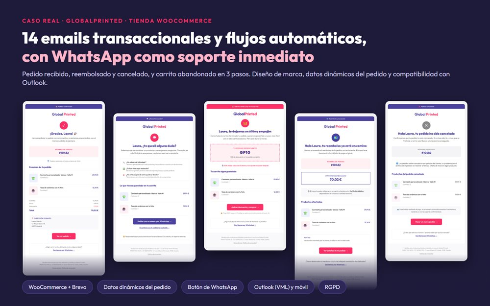 **GlobalPrinted** · 14 emails transaccionales y flujos de WooCommerce con Brevo, a prueba de Outlook | 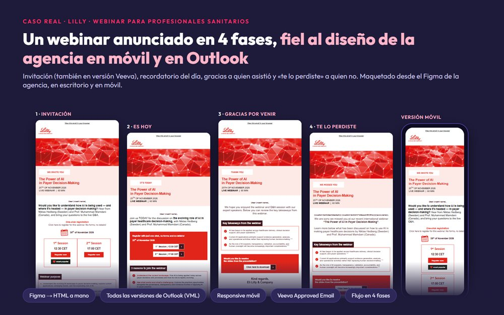 **Lilly** · Flujo de 4 emails para un webinar a profesionales sanitarios |
| 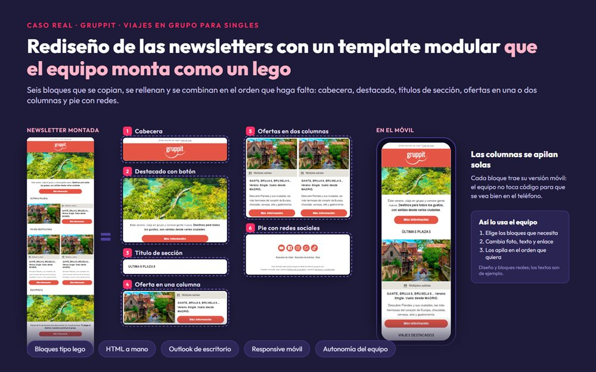 **Gruppit** · Template modular de 6 bloques que su equipo combina sin tocar código | 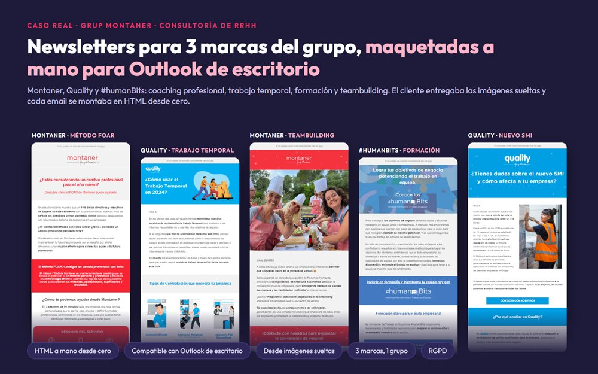 **Grup Montaner** · Newsletters para tres marcas, en HTML a mano |
| 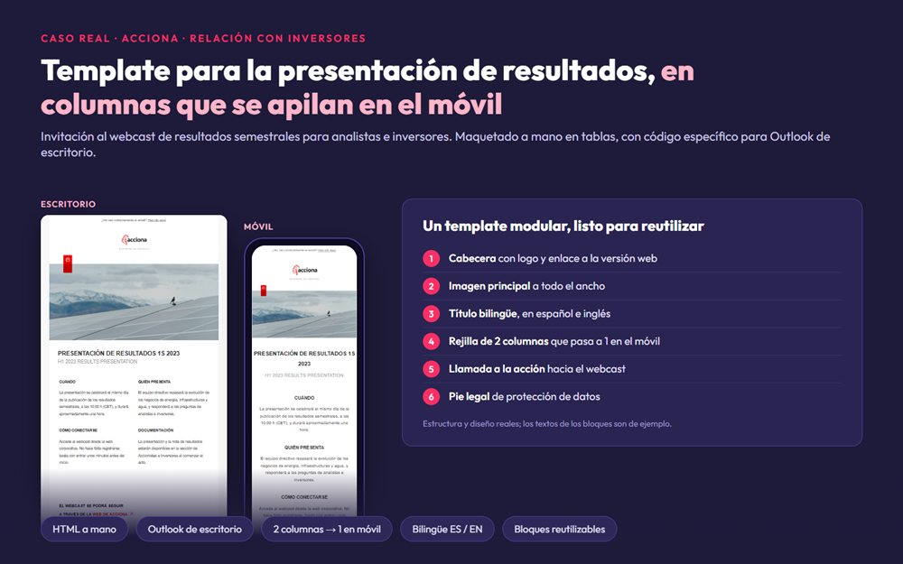 **Acciona** · Template del webcast de resultados para inversores | 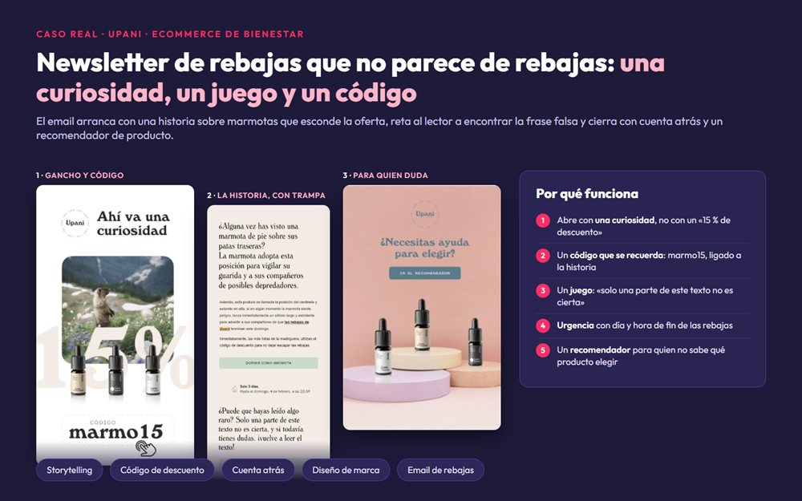 **Upani** · Newsletters de tienda online y auditoría de email |
| 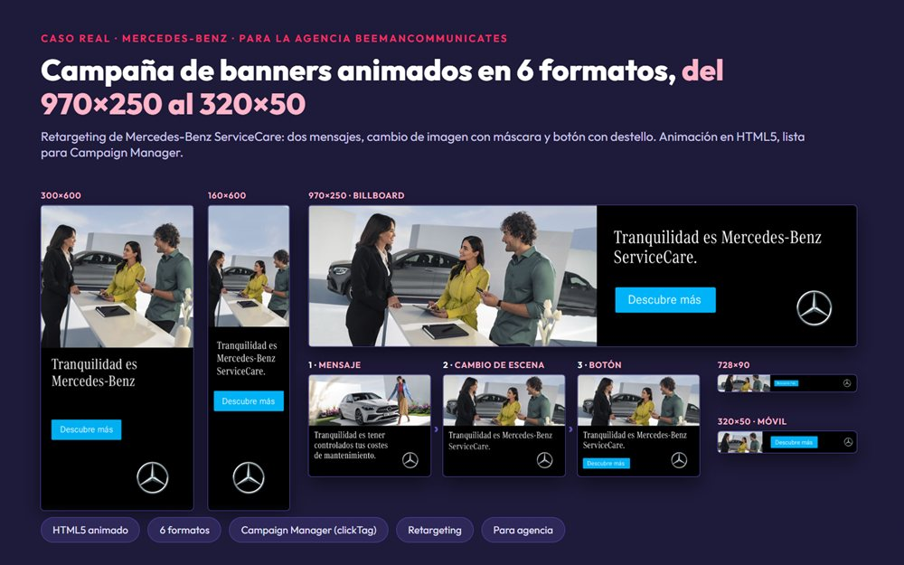 **Mercedes-Benz** · Banners animados en HTML5 en 6 formatos | 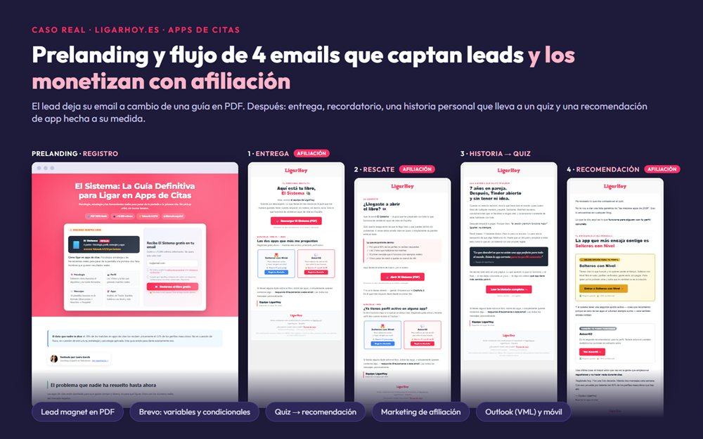 **LigarHoy** · Prelanding y flujo de 4 emails con afiliación |

## Herramientas con IA

| | |
|---|---|
| 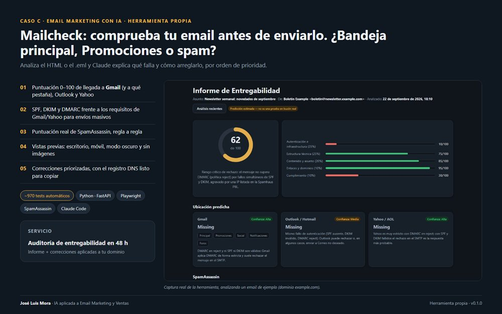 **Mailcheck** · Comprueba un email antes de enviarlo | 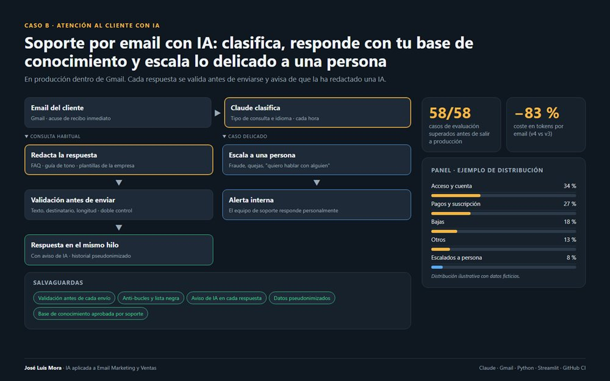 **Atención al cliente con IA** · Clasifica, responde y escala |
| 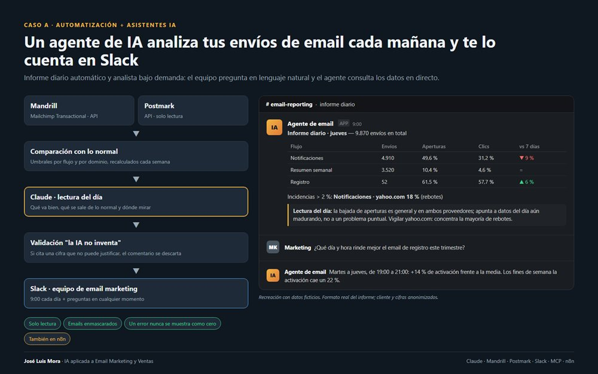 **Informe diario en Slack** · Un agente analiza tus envíos cada mañana | 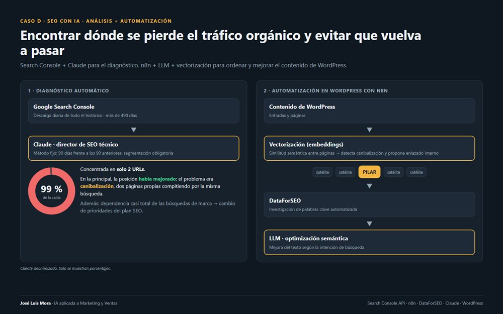 **SEO con IA** · Search Console y WordPress con n8n |

## Han confiado en mí

Canon · Decathlon · Esade · Lilly · Mercedes-Benz · Acciona · H10 Hoteles · Ogilvy · Grup Montaner · GlobalPrinted · Gruppit · Upani · Hallon · Experian CheetahMail
